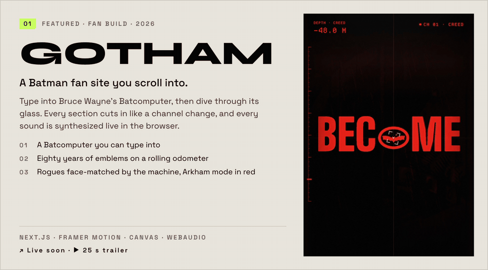
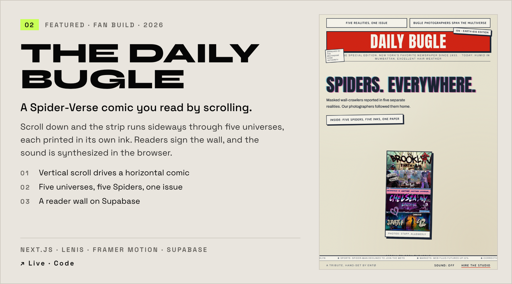
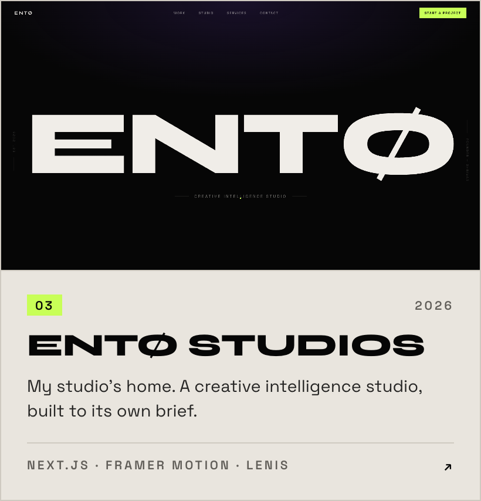
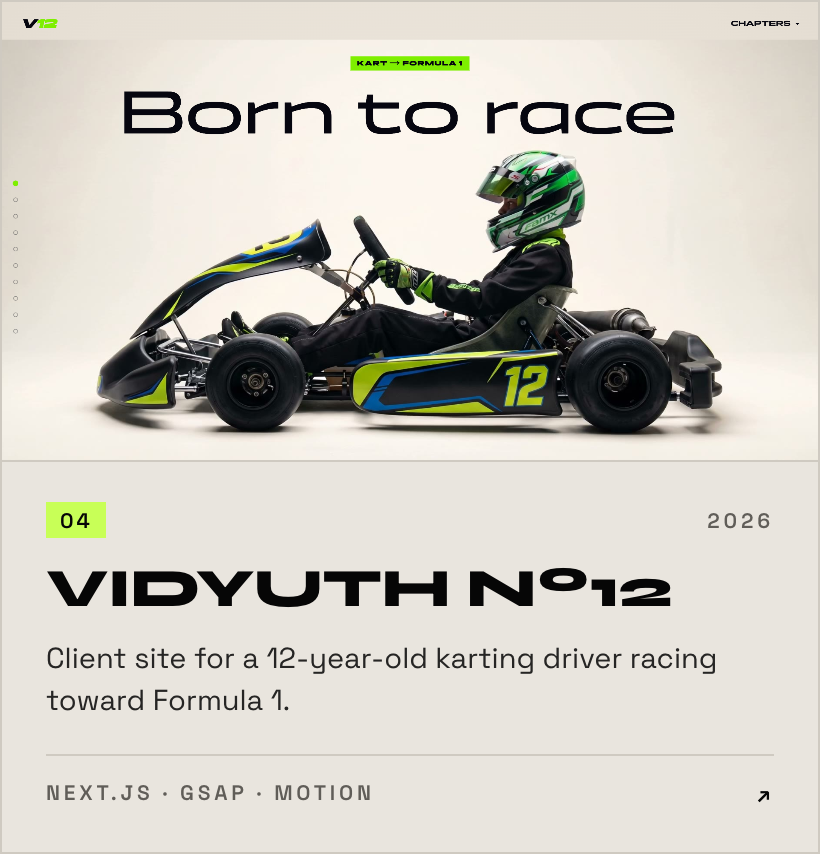
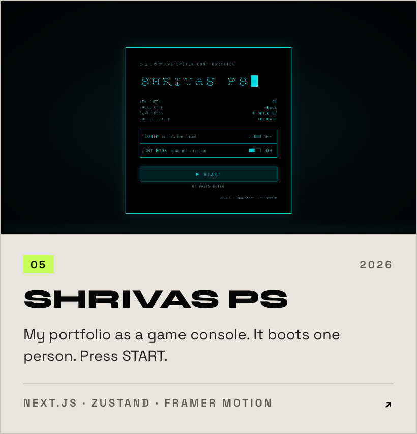
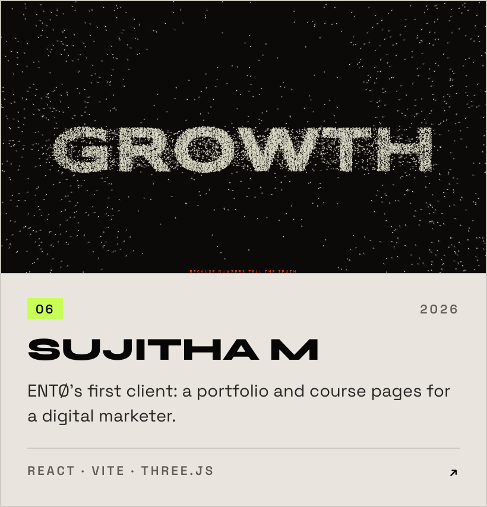
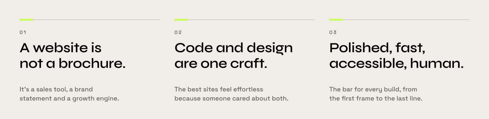

<!-- Every graphic on this page is hand-built. The source lives in /design. -->

  

I'm Shrivas, based in Dundee, Scotland. I run [ENTØ Studios](https://entostudios.com), a creative intelligence studio, and I design and build websites end to end: the brand, the copy, the motion and the code that ships it.

My portfolio is [Shrivas PS](https://shrivas-console.vercel.app), a console that boots one person. Every build gets the same bar: polished, fast, accessible, human.

 

<picture>
  <source media="(prefers-color-scheme: dark)" srcset="./assets/section-work-dark.svg">
  
</picture>

<a href="https://gotham-ashen.vercel.app">
  <picture>
    <source media="(prefers-color-scheme: dark)" srcset="./assets/card-gotham-dark.gif">
    
  </picture>
</a>

**Gotham** &nbsp;·&nbsp; [Visit it live](https://gotham-ashen.vercel.app) &nbsp;·&nbsp; [▶ Watch the 25 s trailer](./assets/gotham-trailer.mp4) &nbsp;·&nbsp; [Code](https://github.com/Shrivas29/GOTHAM)

  

<a href="https://spiderverse-lovat.vercel.app">
  <picture>
    <source media="(prefers-color-scheme: dark)" srcset="./assets/card-bugle-dark.png">
    
  </picture>
</a>

**The Daily Bugle** &nbsp;·&nbsp; [Read it live](https://spiderverse-lovat.vercel.app) &nbsp;·&nbsp; [Code](https://github.com/Shrivas29/spiderverse)

  

  <a href="https://entostudios.com"><picture><source media="(prefers-color-scheme: dark)" srcset="./assets/card-ento-dark.png"></picture></a>
  <a href="https://vidyuth-portfolio.vercel.app"><picture><source media="(prefers-color-scheme: dark)" srcset="./assets/card-vidyuth-dark.png"></picture></a>

  <a href="https://shrivas-console.vercel.app"><picture><source media="(prefers-color-scheme: dark)" srcset="./assets/card-console-dark.png"></picture></a>
  <a href="https://sujitha-portfolio-pi.vercel.app"><picture><source media="(prefers-color-scheme: dark)" srcset="./assets/card-sujitha-dark.png"></picture></a>

 

<picture>
  <source media="(prefers-color-scheme: dark)" srcset="./assets/section-index-dark.svg">
  
</picture>

| Nº | Project | What it is | Live | Code |
| :-- | :-- | :-- | :-- | :-- |
| 01 | **Gotham** | Batman fan site you scroll into | [live](https://gotham-ashen.vercel.app) | [code](https://github.com/Shrivas29/GOTHAM) |
| 02 | **The Daily Bugle** | Spider-Verse comic, read by scrolling | [live](https://spiderverse-lovat.vercel.app) | [code](https://github.com/Shrivas29/spiderverse) |
| 03 | **ENTØ Studios** | My studio's site | [entostudios.com](https://entostudios.com) | [code](https://github.com/Shrivas29/ENTO) |
| 04 | **Vidyuth Nº12** | Client site, karting driver | [live](https://vidyuth-portfolio.vercel.app) | [code](https://github.com/Shrivas29/VIDYUTH-PORTFOLIO-) |
| 05 | **Shrivas PS** | Portfolio as a game console | [live](https://shrivas-console.vercel.app) | [code](https://github.com/Shrivas29/SHRIVAS---CONSOLE-) |
| 06 | **Sujitha M** | Client site, digital marketer | [live](https://sujitha-portfolio-pi.vercel.app) | [code](https://github.com/Shrivas29/SUJITHA-PORTFOLIO) |
| 07 | **Portfolio, first edition** | Where it started | [live](https://portfolio-website-mauve-rho-46.vercel.app) | [code](https://github.com/Shrivas29/PORTFOLIO-WEBSITE-) |
| 08 | **NAVIGATE** | AI and VR travel concept | concept | [code](https://github.com/Shrivas29/NAVIGATE) |

 

<picture>
  <source media="(prefers-color-scheme: dark)" srcset="./assets/section-practice-dark.svg">
  
</picture>

<picture>
  <source media="(prefers-color-scheme: dark)" srcset="./assets/principles-dark.svg">
  
</picture>

 

<picture>
  <source media="(prefers-color-scheme: dark)" srcset="./assets/section-toolkit-dark.svg">
  
</picture>

**Build** &nbsp; Next.js · React · TypeScript · Tailwind CSS · Vite 
**Motion and 3D** &nbsp; Framer Motion · GSAP · Lenis · Three.js · Canvas · WebAudio 
**Ship and test** &nbsp; Vercel · Supabase · Playwright · Vitest

 

<picture>
  <source media="(prefers-color-scheme: dark)" srcset="./assets/section-contact-dark.svg">
  
</picture>

Open to roles in design engineering and creative development, and to studio projects through ENTØ.

[Portfolio](https://shrivas-console.vercel.app) &nbsp;·&nbsp; [entostudios.com](https://entostudios.com) &nbsp;·&nbsp; [shrivasvm@gmail.com](mailto:shrivasvm@gmail.com) &nbsp;·&nbsp; [LinkedIn](https://www.linkedin.com/in/shrivas-vm-612540250/) &nbsp;·&nbsp; [Instagram](https://www.instagram.com/buildwithento/)

 

<picture>
  <source media="(prefers-color-scheme: dark)" srcset="./assets/signoff-dark.svg">
  
</picture>
